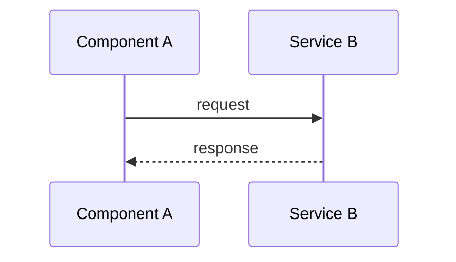

# [Title]

## Overview

[1-2 sentence summary: what the plan delivers and why it matters]

**Sources:**
- S1: [prompt / file name, section or line]
- S2: [...]

**Out of scope:** [exclusions copied from the source, each with its source reference, e.g. "Mobile client (S1 §3)"]

## High-Level Technical Design

> **Note:** Directional guidance for review, not an implementation specification. The implementation phase decides naming, abstractions, and code structure.

[Provide ONE of: Mermaid diagram, pseudo-code sketch, or data-flow map]

## Implementation Units

- U1. **[Unit Name]**
  - **Source:** S1
  - **Goal:** [What this unit accomplishes]
  - **Dependencies:** None
  - **Files:**
    - Create: `path/to/file`
    - Test: `path/to/test`
  - **Acceptance Criteria:**
    - AC1.1: [Single, verifiable criterion]
  - **Test Scenarios:**
    - AC1.1 — [Scenario]: [Input] -> [Expected outcome]

- U2. **[Unit Name]**
  - **Source:** S1, S2
  - **Goal:** [...]
  - **Dependencies:** U1
  - **Files:**
    - Modify: `path/to/file`
    - Test: `path/to/test`
  - **Acceptance Criteria:**
    - AC2.1: [...]
    - AC2.2: [...]
  - **Test Scenarios:**
    - AC2.1 — [Scenario]: [Input] -> [Expected outcome]
    - AC2.2 — [Scenario]: [Input] -> [Expected outcome]

## Alternative Approaches Considered

- **[Approach Name]**: [Description] → **Rejected because:** [Rationale]
- (Only real alternatives; if the source fixes the approach, say so in one line)

## Risk Analysis & Mitigation

| Risk                        | Impact | Mitigation                                    |
| --------------------------- | ------ | --------------------------------------------- |
| [Specific risk description] | High   | [Concrete step to prevent or recover from it] |

## Operational / Rollout Notes

[Only the items that apply — feature flags, monitoring, data migration, rollback plan, performance baseline. Otherwise one line: `Not applicable — <reason>`]

## Open Decisions

- **OD1:** [Question the source does not settle] — Recommended: [default and why] — Affects: U2
- (`None.` when empty)

## Learning Gaps

- [Gap found during planning that should be documented after implementation]
- (`None.` when empty)
